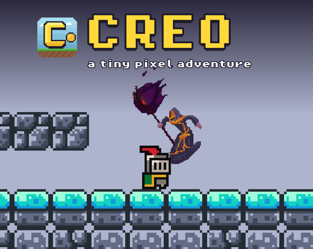
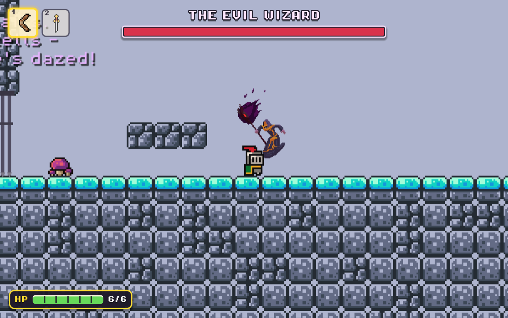
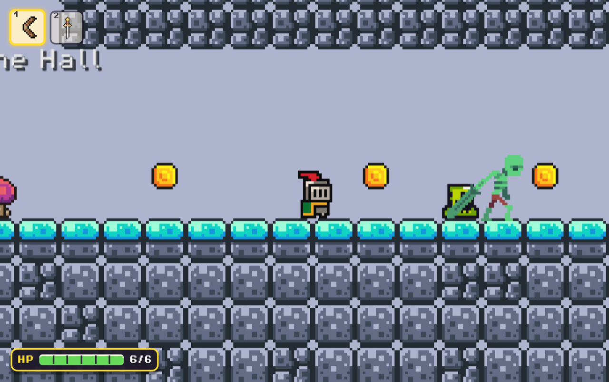
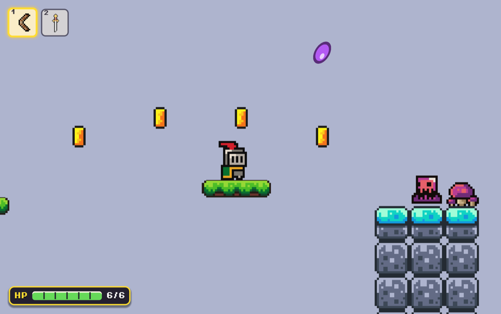
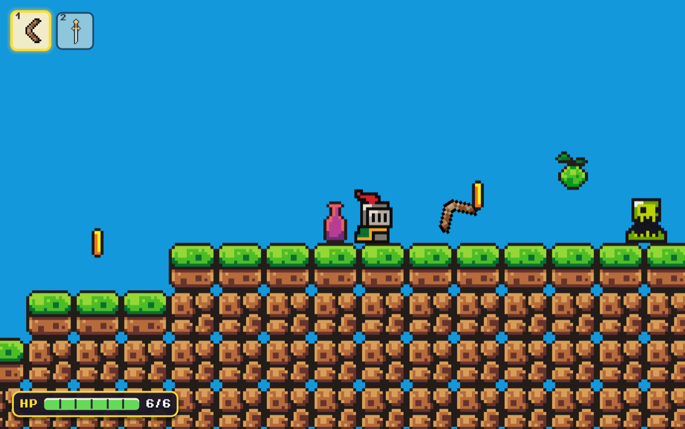
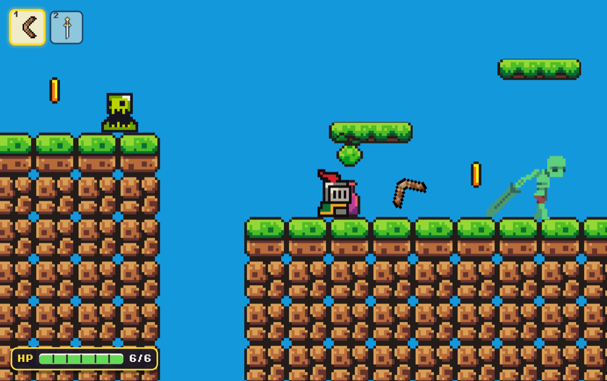
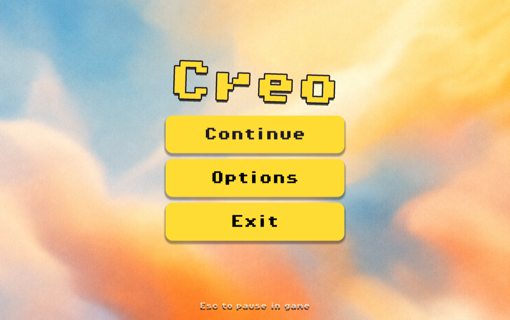

# Creo 🗡️

hii this is **creo**, my first ever real game!! its a little pixel platformer where u are a tiny knight and u jump around, smack goblins and skeletons, collect coins and then fight a big evil wizard at the end :D

i made it in **Godot 4** and it took me way longer than i thought lol

## play it

play in browser on itch.io https://rusilkoirala.itch.io/creo

## controls

btw i know how to make this table in .md :)
| key | what it do |
|---|---|
| A / D or arrows | walk |
| Space | jump (press again in air for double jump if u bought it) |
| Q | dash |
| F or J | attack (spam it for combos) |
| Tab / 1 2 3 | switch weapon |
| E | pick up stuff |
| Esc | pause |

## whats in it

- 5 levels + a tutorial level
- goblins, skeletons and a purple slime that spits goo at u (hes so annoying)
- a sword and a boomerang that comes back
- a **shop** where u spend coins on double jump, air dash, extra hearts and dash strike
- checkpoints so u dont cry when u die
- a secret heart hidden in level 5 (good luck finding it hehe)
- **BOSS FIGHT** with the evil wizard. he has like 5 attacks and gets angry at half hp
- a little ending screen when u win :)

## screenshots

## did i use AI?

yes, i did. i used AI (Claude) to help **polish** the game, like making the game feel juicier, fixing bugs i couldnt figure out and cleaning up my messy code.

i also used it to **learn** how to make stuff i had no idea how to do. like how to make a boss with phases, how checkpoints work, how to make an upgrade shop that saves, how moving platforms work in godot, how to export to web, etc. questions and then messed around with it until it worked.

the idea, most of the levels and all the playtesting (dying 100 times) was me tho

## credits

- knight, slimes, tiles  BRAKEYSSS
- evil wizard sprite is CC0 from the Evil Wizard 2 pack

- made by @rusilkoirala

if u play it pls tell me what u think!! ⭐ the repo if u liked it
